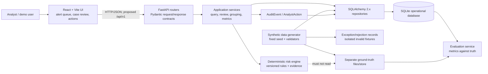
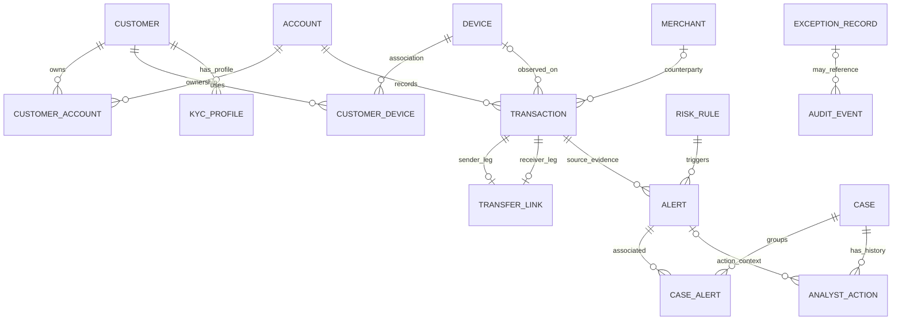
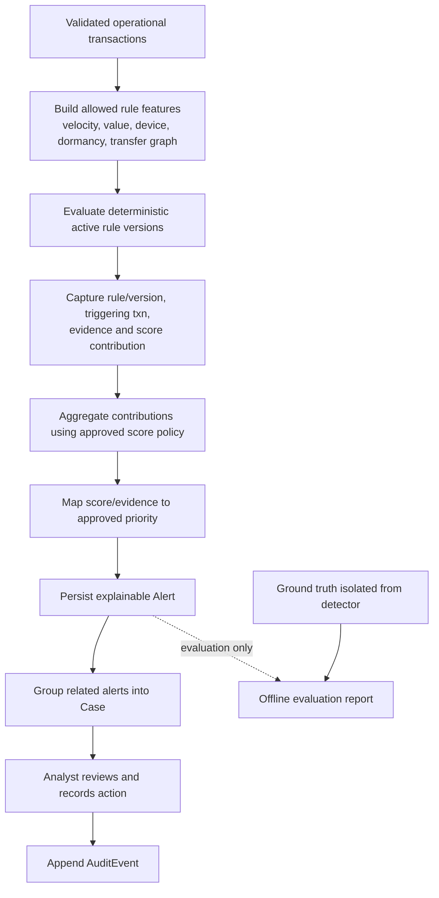
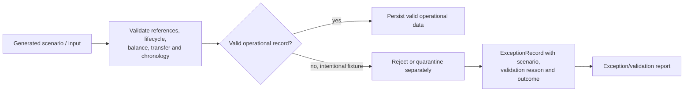

# Phase 2: System Architecture

**Project:** RiskTrace AI  
**Status:** Architecture baseline documented from the hackathon requirements. Diagrams and API contracts below are proposed design contracts for review, not implemented application functionality.

## 1. Architecture goals

- Keep presentation, application logic, and relational persistence in separate tiers.
- Provide deterministic, explainable risk decisions with traceable evidence.
- Preserve relational and temporal integrity.
- Prevent ground-truth labels from entering detector inputs.
- Quarantine deliberately invalid scenarios without weakening operational constraints.
- Support a 100,000-transaction synthetic baseline on SQLite and avoid unnecessary database-specific coupling.

## 2. Three-tier architecture

| Tier | Responsibility | Required technology | Current implementation |
|---|---|---|---|
| Presentation | Analyst alert/case review, evidence, filters, and dispositions | React, Vite, JavaScript, CSS | Generic Vite/React starter screen only; no product UI or API client |
| Application/API | Validation, use cases, rules, case grouping, audit, evaluation orchestration | Python, FastAPI, Pydantic, SQLAlchemy 2.x | Minimal `FastAPI(title="RiskTrace AI")`; framework docs routes only |
| Relational data | Operational entities, constraints, indexes, action/audit history | SQLite for hackathon; PostgreSQL compatibility considered | No engine, session, models, migrations, schema, or database file |

The frontend and backend currently run independently. There is no browser-to-API or API-to-database integration.

## 3. Proposed component architecture



Ground truth is reachable only by the evaluation path. The detector and operational query path must not read labels, label-derived features, or scenario identifiers that reveal labels.

## 4. Proposed ER design (conceptual; Phase 4 must refine)

This diagram expresses requested entities and likely relationships. It is not a finalized schema: fields, cardinalities, nullable behavior, uniqueness, keys, delete rules, and temporal semantics require the Phase 4 data dictionary.



### Relationship intent

- Customer and Account use `CustomerAccount` to represent ownership; joint ownership remains possible.
- Customer and Device use `CustomerDevice` to represent observed association and potential first/last-seen context.
- Account owns transaction activity. Merchant and Device are optional transaction references depending on transaction type.
- `TransferLink` references sender and receiver transaction legs and carries reconciliation state/evidence. Currency, fee, partial-transfer, and reversal semantics are TBD.
- Each Alert references the exact rule version used and source transaction/evidence. A historical rule definition or immutable snapshot is needed to reproduce the decision.
- Case and Alert associate through `CaseAlert`, allowing multiple alerts per case. Whether an alert may be reassigned or belong to multiple cases is TBD.
- AnalystAction records time-ordered review/disposition history; its relationship to Case and optional Alert must be resolved.
- `ExceptionRecord` stores a deliberately invalid/rejected scenario and reason outside valid operational records. `AuditEvent` captures material changes; exact entity linkage/retention is TBD.
- KYCProfile cardinality/versioning, and required/optional customer links, must be finalized during Phase 4.

## 5. API contract baseline (proposed, not implemented)

### Contract conventions

- Base path proposal: `/api/v1`.
- JSON request/response bodies with Pydantic validation.
- Stable public IDs follow the agreed ID grammar; do not assume the ambiguous example `ACC--01` is final.
- Timestamps should be serialized as ISO 8601 with an explicit UTC offset; exact storage/timezone policy is Phase 4.
- Monetary values must use a documented decimal/string representation and currency; do not use binary floating-point for money.
- List responses should use documented pagination (initial proposal: `limit` and opaque `cursor`) and stable ordering. Cursor format and maximum page size are TBD.
- Standard errors should include a stable machine-readable `code`, human-readable `message`, optional field `details`, and request/correlation ID. Avoid exposing stack traces or sensitive fields.
- Authentication/authorization is not specified; the proposed contracts do not imply that endpoints are safe to expose publicly.

### Proposed endpoints

| Method and path | Purpose | Proposed success / errors |
|---|---|---|
| `GET /health` | Process/liveness check; future readiness may check DB separately | `200` with service status; `503` if readiness is requested and dependency is unavailable |
| `GET /api/v1/alerts` | Filter and page prioritized alerts | `200` page with alert summary/evidence pointer; `400` invalid filters; `422` invalid parameter format |
| `GET /api/v1/alerts/{alert_id}` | Retrieve a single alert and its explainability evidence | `200`; `404` unknown ID |
| `GET /api/v1/cases` | Filter/page review cases by lifecycle/priority | `200`; `400` invalid filters |
| `GET /api/v1/cases/{case_id}` | Retrieve case, associated alerts, and action history | `200`; `404` unknown ID |
| `POST /api/v1/cases/{case_id}/actions` | Record an analyst action/disposition | `201` persisted action; `404` unknown case; `409` invalid state/chronology conflict; `422` invalid body |
| `GET /api/v1/rules` | Read active/versioned rule metadata for explainability | `200`; `404` if a specific version is not found |
| `GET /api/v1/metrics` | Retrieve a documented evaluation/operational report | `200`; `409` if evaluation inputs/ground truth are unavailable or mismatched |

These endpoints are an initial contract proposal, not current routes. Finalize naming, auth, filtering, pagination, case/action state, and error semantics before implementation. Synthetic generation is initially better specified as a reproducible command/service than an unprotected public endpoint; whether an admin API is needed is TBD.

### Proposed payload shapes

Examples show field intent only; they are not approved Pydantic schemas.

Alert summary:

```json
{
  "alert_id": "ALT-2026-000001",
  "priority": "TBD",
  "score": "TBD",
  "triggered_rule": {
    "rule_id": "TBD",
    "version": "TBD"
  },
  "triggering_transaction_id": "TXN-2026-00000001",
  "detected_at": "2026-01-01T12:00:00Z",
  "evidence": [],
  "case_ids": []
}
```

Analyst action request:

```json
{
  "disposition": "TBD",
  "note": "Optional analyst rationale",
  "actor_id": "TBD"
}
```

The disposition vocabulary, actor identity/auth model, score scale, evidence schema, and exact requirement for a note must be resolved. Do not use these examples to seed production values.

## 6. Data flow

1. Read seed/config version and generate master records (customers, merchants, devices, accounts, KYC, ownership associations).
2. Generate transaction activity and paired transfer links using valid foreign keys.
3. Derive account balances/statuses from source activity under approved ledger and lifecycle semantics.
4. Validate IDs, references, transaction state, balances, transfer reconciliation, and counts.
5. Route intentionally invalid scenarios to a separate rejection/exception path; do not insert them into valid operational tables.
6. Generate/maintain ground-truth labels in a separate artifact/store, inaccessible to detector data access.
7. Run versioned risk rules only against permitted operational data/features.
8. Persist alert evidence, score contributions, rule version, trigger transaction, detection timestamp, and priority.
9. Group related alerts into cases under a documented deterministic linkage policy.
10. Let analysts retrieve evidence and append actions/dispositions and audit events through the API.
11. Evaluate outputs against the separate ground truth and emit a report with defined unit, formulas, and thresholds.

## 7. Risk-engine workflow



Initial rules: transaction velocity spike, high-value transaction, new-device activity, dormant-account reactivation, and circular transfers. Thresholds, lookback windows, contribution weights, score scale, aggregation/caps, priority bands, tie-breaking, rule lifecycle, and metric definitions are open decisions. Detection must be deterministic and explainable; ground truth must not be used to calculate detection features or determine alerts.

## 8. Exception and invalid-scenario workflow



Required exception cases:

1. Transaction references a closed account.
2. Negative balance exists without overdraft.
3. Transfer legs do not reconcile.
4. Alert has no triggering transaction.
5. Case disposition precedes its alert.

For each, retain the input/scenario identifier, validation rule, reason, and reject/quarantine outcome. Keep invalid rows out of operational tables unless there is an explicitly designed safe representation. Preserve strict foreign-key and chronology constraints for valid records. Phase 4/5 must decide whether to use `ExceptionRecord`, rejected-row exports, or isolated test fixtures, and ensure invalid test fixtures do not compromise live/demo data.

## 9. Cross-cutting requirements

- **Auditability:** keep analyst actions and material changes time ordered; define correction/undo semantics.
- **Security/privacy:** synthetic-only data; authentication and authorization are open requirements; do not expose admin/generation behavior without a policy.
- **Reliability:** explicit validation and errors; avoid success-shaped fallbacks.
- **Performance:** measure generation, indexing, alert queries, and case loading on the 100,000-transaction baseline before claiming capacity.
- **Portability:** SQLite is the hackathon database; PostgreSQL compatibility is a future consideration and should be tested if treated as a delivery requirement.
- **Testing:** pytest/HTTPX API and data-integrity tests, frontend build verification, and later end-to-end coverage. No business or API tests currently exist.

## 10. Current versus proposed status

| Capability | Current evidence | Proposed target |
|---|---|---|
| Frontend | Vite/React starter counter/tutorial | Analyst alert and case workflow |
| API | FastAPI docs/OpenAPI framework routes; no business routes | Versioned health, alert, case, action, rule, and metrics contracts |
| Database | None | Relational SQLite schema via SQLAlchemy |
| Data generation | None | Deterministic generator and validation |
| Risk rules | None | Versioned explainable rules and evidence |
| Cases/actions/audit | None | Grouped case workflow and append-oriented history |
| Exceptions | None | Isolated invalid scenarios with validation outcomes |
| Evaluation | None | Separate ground-truth evaluation/reporting path |

Proceed to Phase 4 only after reviewing this proposed architecture and producing an approved data dictionary. Do not treat this document as implemented code or as a substitute for the Phase 4 schema.
