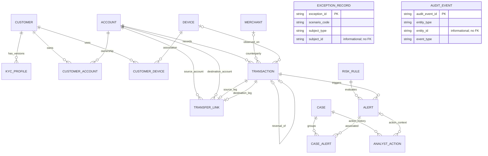

# Phase 4: Database Design and Data Dictionary

**Status:** Approved Phase 4 design baseline; the SQLAlchemy implementation and migration are documented in [Phase 5](05_database_implementation.md).
**Stack:** SQLite for the hackathon; SQLAlchemy 2.x and Pydantic in later phases; PostgreSQL compatibility considered where practical.
**Design baseline:** 2026 synthetic-data namespace and the requirements in [Phase 1](01_problem_analysis.md) and [Phase 2](02_system_architecture.md).

## 1. Design scope and conventions

This specification covers the 10 core entities and six supporting entities requested in the project brief. The nine decisions listed in Section 11 were approved by the user on 2026-11-11 and are the implementation baseline. “Required” means `NOT NULL` in a valid operational row. “Optional” means nullable. Unless stated otherwise, a field has no database default; generators/services must supply it. IDs are application-generated, immutable text primary keys. Do not use database rowids as public IDs.

Physical table names use lowercase `snake_case`; reserved/common SQL nouns are disambiguated as `transaction_record` and `case_record`. The logical entity names in the ER diagram remain Transaction and Case.

### Portable SQL types

| Logical type | SQLite representation | PostgreSQL representation | Use |
|---|---|---|---|
| `TEXT` | `TEXT` | `TEXT`/`VARCHAR` | IDs, codes, names, ISO currency |
| `INTEGER` | signed integer | `INTEGER` | booleans (`0/1`), small enums, scores |
| `BIGINT` | signed 64-bit integer affinity | `BIGINT` | minor-unit monetary amounts |
| `TIMESTAMP_UTC` | ISO-8601 UTC text via SQLAlchemy `DateTime`; SQLite does not enforce timezone | `TIMESTAMP WITH TIME ZONE` | event/effective timestamps |
| `JSON` | JSON text (optionally guarded with SQLite JSON1) | `JSONB` or SQLAlchemy JSON | evidence/metadata not used as primary filter keys |

Normalize instants to UTC at the application boundary and serialize with an explicit `Z`/offset. SQLite does not preserve/enforce timezone metadata; use a single tested SQLAlchemy conversion policy. Use parameterized ORM statements. Avoid database-specific JSON queries in core workflows.

### Money and balance rules

- Store money as signed 64-bit **integer minor units**, never binary floating point. The approved synthetic baseline is USD-only, with exponent 2; reject other currencies in this dataset. A future multi-currency design must supply a controlled currency/exponent definition.
- Debit and credit columns are non-negative magnitudes; for a posted ledger transaction exactly one is positive and the other is zero.
- Transaction balance snapshots satisfy `closing_balance_minor = opening_balance_minor - debit_minor + credit_minor`.
- The authoritative balance is derived from the account opening balance and ordered posted ledger entries. Transaction opening/closing balances are immutable reconciliation snapshots, not independently randomized/current-balance fields.
- A reversal is a new posted transaction referencing the original transaction and carrying the exactly opposite debit/credit in the same account/currency. Never delete or rewrite the original entry.
- Transfers have one same-currency debit leg and one equal credit leg. Fees, partial transfers, cross-currency transfers, and FX are out of scope; change this only with an explicit design revision.

### Identifier conventions

All IDs are immutable and consistently referenced. Values are generated deterministically by the data generator/application and protected by primary-key constraints, ORM update guards, and SQLite triggers; there is no mutable-ID update workflow.

| Entity | Pattern/example | Rule |
|---|---|---|
| Customer | `CUS-000001` | six-digit, one-based sequence |
| Account | `ACC--01` | exact required prefix `ACC--`, followed by a one-based decimal ordinal, minimum width two and expanded as needed (`ACC--01`…`ACC--99`, `ACC--100`…); supports at least 7,000 accounts |
| Transaction | `TXN-2026-00000001` | four-digit dataset/event namespace year and eight-digit sequence |
| Alert | `ALT-2026-000001` | four-digit dataset namespace year and six-digit sequence |
| Case | `CASE-2026-000001` | four-digit dataset namespace year and six-digit sequence |
| Merchant | `MER-000001` | six-digit sequence |
| Device | `DEV-000001` | six-digit sequence |
| TransferLink | `TRF-2026-000001` | namespace year and six-digit sequence |
| RiskRule version | `RUL-{rule_key}-V01` | stable key plus two-digit-or-wider positive version |
| KYCProfile | `KYC-000001` | six-digit sequence; `version` also unique per customer |
| CustomerAccount | `OWN-000001` | six-digit association sequence; unique customer/account/effective-start |
| CustomerDevice | `CDV-000001` | six-digit association sequence; unique customer/device association |
| CaseAlert | `CAL-000001` | six-digit association sequence; unique case/alert pair |
| AnalystAction | `ACT-2026-000001` | namespace year and six-digit sequence |
| ExceptionRecord | `EXC-2026-000001` | namespace year and six-digit sequence |
| AuditEvent | `AUD-2026-000001` | namespace year and six-digit sequence |

The `2026` segment is the fixed namespace for this baseline and is not necessarily the transaction timestamp year. Later datasets require an explicitly selected new namespace; do not silently reuse IDs across datasets.

## 2. Entity and relationship overview

### Core entities

Customer, Account, Merchant, Device, Transaction, TransferLink, RiskRule, Alert, Case, AnalystAction.

### Supporting entities

KYCProfile, CustomerAccount, CustomerDevice, CaseAlert, ExceptionRecord, AuditEvent.

### Cardinalities, foreign keys, optionality, and deletion policy

Physical deletion of operational rows is prohibited in the baseline. Use lifecycle transitions/retention policy instead. All listed foreign keys use `ON DELETE RESTRICT` (including nullable optional FKs when populated); no cascading delete can erase transaction, alert, case, analyst, or audit history.

| Parent → child | Cardinality | Foreign-key design | Optionality and policy |
|---|---|---|---|
| Customer → KYCProfile | 1 to 0..many | `kyc_profile.customer_id → customer.customer_id` | KYC version rows require a customer; restrict physical deletion. |
| Customer ↔ Account via CustomerAccount | many-to-many; each association has 1 Customer and 1 Account | `customer_account.customer_id`, `account_id` | Ownership association is required per row; multiple customers/joint owners allowed. End ownership with `valid_to`/status, not delete. |
| Customer ↔ Device via CustomerDevice | many-to-many; each association has 1 Customer and 1 Device | `customer_device.customer_id`, `device_id` | Required per association; revoke/end rather than delete. |
| Account → Transaction | 1 to 0..many | `transaction.account_id → account.account_id` | Required; restrict deleting account with transaction history. |
| Merchant → Transaction | 1 to 0..many | nullable `transaction.merchant_id → merchant.merchant_id` | Optional for cash, transfer, and other non-merchant activity; restrict deletion if referenced. |
| Device → Transaction | 1 to 0..many | nullable `transaction.device_id → device.device_id` | Optional when device is not known/applicable; restrict deletion if referenced. |
| Account → TransferLink source | 1 to 0..many | `transfer_link.source_account_id → account.account_id` | Required source account; restrict deletion. |
| Account → TransferLink destination | 1 to 0..many | `transfer_link.destination_account_id → account.account_id` | Required destination account; restrict deletion. |
| Transaction → TransferLink source leg | 1 to 0..1 | `transfer_link.source_transaction_id → transaction.transaction_id` | Required on transfer links; unique, restrict deletion. |
| Transaction → TransferLink destination leg | 1 to 0..1 | `transfer_link.destination_transaction_id → transaction.transaction_id` | Required on transfer links; unique, restrict deletion. |
| RiskRule → Alert | 1 to 0..many | `alert.rule_id → risk_rule.rule_id` | Required; rule version is immutable once referenced, restrict deletion. |
| Transaction → Alert | 1 to 0..many | `alert.triggering_transaction_id → transaction.transaction_id` | Required for every operational alert; an orphan is only an exception record, never a valid alert. |
| Case ↔ Alert via CaseAlert | many-to-many; each association has 1 Case and 1 Alert | `case_alert.case_id`, `alert_id` | Both required. Reassignment/removal is an audited association event; retain historical audit. |
| Case → AnalystAction | 1 to 0..many | `analyst_action.case_id → case.case_id` | Required. Actions are append-only and restrict case deletion. |
| Alert → AnalystAction | 1 to 0..many | nullable `analyst_action.alert_id → alert.alert_id` | Optional for case-level actions; if present, the alert must be associated with that case at action time. |
| Operational subject → ExceptionRecord | no FK to invalid subject by design | `subject_type`, optional `subject_id`, raw `payload_json` | Exception may describe a nonexistent/invalid FK target; polymorphic reference is informational, not an FK. |
| Entity → AuditEvent | 0..many events per entity | `entity_type` + `entity_id` text pair | Polymorphic audit target is intentionally not an FK. Actor fields do not reference an Analyst entity (none requested). |

For transfer legs, additionally enforce composite relationships `(source_account_id, source_transaction_id)` and `(destination_account_id, destination_transaction_id)` to a unique `(account_id, transaction_id)` key on Transaction. This prevents a link from naming a transaction posted to a different account. Add SQLAlchemy/table-level constraints; validate same-currency and amounts in a service transaction.

## 3. Complete Mermaid ER diagram

The diagram includes all 10 core and six supporting entities. It represents the design above; it is not an implemented schema.

The diagram names all 16 entities. `ExceptionRecord.subject_type/subject_id` and `AuditEvent.entity_type/entity_id` are independent informational polymorphic references and intentionally have no FK relationship to each other or to operational entities; both are shown without Mermaid relationship edges. `CustomerAccount` and `CustomerDevice` are association entities; `CaseAlert` preserves case-alert association and link metadata.

## 4. Data dictionary

Abbreviations: **R** required, **O** optional; **PK** primary key; **FK** foreign key. “—” means no default and no uniqueness constraint beyond any key/constraint stated. Every table has exactly the declared primary key; all IDs are supplied by the application, not auto-incremented. SQL types use the portable mapping above. Allowed values shown are closed baseline enums; extend only through a documented migration/design update.

### 4.1 Customer (core)

| Field | SQL type | Req? | Key | Allowed/default | Unique/validation | Description |
|---|---|---:|---|---|---|---|
| `customer_id` | TEXT | R | PK | `CUS-` + 6 digits; no default | Unique PK; immutable | Synthetic customer identifier. |
| `status` | TEXT | R | — | `active`, `suspended`, `closed`; default `active` | Enum check; state transition validated | Customer lifecycle state. |
| `created_at` | TIMESTAMP_UTC | R | — | — | UTC instant | Creation time. |
| `updated_at` | TIMESTAMP_UTC | R | — | — | `>= created_at`; updated only with lifecycle/profile change | Last profile/state change; not an audit substitute. |

No names, addresses, government IDs, or real PII are required by the brief. If synthetic attributes are later needed, define them explicitly and keep values synthetic.

### 4.2 Account (core)

| Field | SQL type | Req? | Key | Allowed/default | Unique/validation | Description |
|---|---|---:|---|---|---|---|
| `account_id` | TEXT | R | PK | `ACC--` + ordinal, minimum 2 digits, e.g. `ACC--01`; no default | Unique PK; immutable | Required public account ID format. |
| `currency` | TEXT | R | — | `USD` | Check `currency = 'USD'`; account currency immutable after first posted transaction | Ledger currency for the approved synthetic baseline. |
| `opening_balance_minor` | BIGINT | R | — | — | Non-negative baseline; if opening debt is needed, model it as a transaction | Opening ledger amount in currency minor units. |
| `overdraft_eligible` | INTEGER | R | — | `0`/`1`; default `0` | Boolean check | Whether policy allows a negative derived balance. |
| `overdraft_limit_minor` | BIGINT | R | — | Default `0` | `>= 0`; must be 0 when not eligible | Maximum permitted negative balance magnitude. |
| `status` | TEXT | R | — | `pending`, `open`, `dormant`, `frozen`, `closed`; default `open` | Enum check; transition validated | Current account lifecycle. |
| `opened_at` | TIMESTAMP_UTC | R | — | — | UTC instant | Account opening time. |
| `closed_at` | TIMESTAMP_UTC | O | — | — | Required iff status is closed (service/state check) | Closure time. |
| `created_at` | TIMESTAMP_UTC | R | — | — | UTC instant | Record creation time. |

Do not store a mutable `current_balance`; derive it from `opening_balance_minor` and posted entries. Account status is current state; transaction records also snapshot status at posting.

### 4.3 Merchant (core)

| Field | SQL type | Req? | Key | Allowed/default | Unique/validation | Description |
|---|---|---:|---|---|---|---|
| `merchant_id` | TEXT | R | PK | `MER-` + 6 digits | Unique PK; immutable | Synthetic merchant identifier. |
| `name` | TEXT | R | — | Synthetic display name | Non-empty, bounded length | Generated merchant name; no real merchant data required. |
| `category_code` | TEXT | R | — | Controlled synthetic category code | Category membership checked against generator dictionary | Merchant category used for analysis. |
| `country_code` | TEXT | O | — | ISO-3166 alpha-2 | Two uppercase letters if present | Synthetic merchant country. |
| `status` | TEXT | R | — | `active`, `inactive`, `blocked`; default `active` | Enum check; transitions validated | Merchant lifecycle. |
| `created_at` | TIMESTAMP_UTC | R | — | — | UTC instant | Record creation time. |

### 4.4 Device (core)

| Field | SQL type | Req? | Key | Allowed/default | Unique/validation | Description |
|---|---|---:|---|---|---|---|
| `device_id` | TEXT | R | PK | `DEV-` + 6 digits | Unique PK; immutable | Synthetic device identifier. |
| `device_type` | TEXT | R | — | `mobile`, `web`, `tablet`, `other` | Enum check | Coarse synthetic device category. |
| `fingerprint_hash` | TEXT | O | UQ | Synthetic opaque token/hash only | Unique when present; never a real fingerprint | Optional stable synthetic device indicator. |
| `status` | TEXT | R | — | `active`, `revoked`, `unknown`; default `active` | Enum check; transitions validated | Device lifecycle. |
| `first_seen_at` | TIMESTAMP_UTC | R | — | — | UTC instant | First generated/observed activity. |
| `created_at` | TIMESTAMP_UTC | R | — | — | UTC instant | Record creation time. |

### 4.5 Transaction (core)

| Field | SQL type | Req? | Key | Allowed/default | Unique/validation | Description |
|---|---|---:|---|---|---|---|
| `transaction_id` | TEXT | R | PK | `TXN-2026-` + 8 digits | Unique PK; immutable | Public transaction ID; year segment is namespace. |
| `account_id` | TEXT | R | FK → Account | Valid account ID | Restrict delete; indexed; composite unique with `transaction_id` | Ledger account. |
| `merchant_id` | TEXT | O | FK → Merchant | — | Restrict delete | Optional merchant for applicable activity. |
| `device_id` | TEXT | O | FK → Device | — | Restrict delete | Optional device observed for activity. |
| `transaction_type` | TEXT | R | — | `purchase`, `cash_withdrawal`, `deposit`, `transfer`, `fee`, `refund`, `adjustment` | Enum check; type/direction compatibility validated | Business activity type. |
| `status` | TEXT | R | — | `pending`, `posted`, `declined`, `voided`; default `pending` | Enum check; transition validated | Transaction lifecycle; only posted entries affect balance. |
| `transaction_at` | TIMESTAMP_UTC | R | — | — | UTC instant; account ledger ordering uses `(transaction_at, transaction_id)` | Time the activity occurred. |
| `posted_at` | TIMESTAMP_UTC | O | — | — | Required iff posted; `>= transaction_at` subject to allowed clock policy | Time entry became part of the ledger. |
| `currency` | TEXT | R | — | `USD` | Check `currency = 'USD'`; must equal account currency | Currency of both amounts and snapshots. |
| `debit_minor` | BIGINT | R | — | Default `0` | `>= 0`; posted row has debit XOR credit > 0 | Debit magnitude in minor units. |
| `credit_minor` | BIGINT | R | — | Default `0` | `>= 0`; posted row has credit XOR debit > 0 | Credit magnitude in minor units. |
| `opening_balance_minor` | BIGINT | O | — | — | Required for posted row | Derived prior balance snapshot before this entry. |
| `closing_balance_minor` | BIGINT | O | — | — | Required for posted row; equals opening - debit + credit | Derived balance snapshot after this entry. |
| `account_status_at_posting` | TEXT | O | — | `open` or `dormant` for posted row | Required for posted row; `closed`/`frozen` not allowed | Snapshot proving account was eligible when posted; closed-account scenarios are rejected/quarantined. |
| `reversal_of_transaction_id` | TEXT | O | FK → Transaction | — | Unique when non-null; referenced transaction must be posted, same account/currency, opposite amount | New compensating entry; original row is not overwritten. |
| `created_at` | TIMESTAMP_UTC | R | — | — | UTC instant | Record creation time. |

For non-posted rows, ledger snapshots and `posted_at` are null. Enforce row-level checks (`debit_minor >= 0`, `credit_minor >= 0`, valid status, posted snapshot presence, and posted amount XOR) in schema; validate cross-row balance sequence, USD currency, lifecycle, and reversal equality in one service transaction. Posted financial fields are immutable.

### 4.6 TransferLink (core)

| Field | SQL type | Req? | Key | Allowed/default | Unique/validation | Description |
|---|---|---:|---|---|---|---|
| `transfer_id` | TEXT | R | PK | `TRF-2026-` + 6 digits | Unique PK; immutable | Transfer relationship identifier. |
| `source_account_id` | TEXT | R | FK → Account | Valid account | Composite FK with source transaction; restrict delete | Sending account. |
| `destination_account_id` | TEXT | R | FK → Account | Valid account | Composite FK with destination transaction; restrict delete | Receiving account; different from source in baseline. |
| `source_transaction_id` | TEXT | R | FK → Transaction | Valid posted debit leg | Unique; composite FK `(source_account_id, source_transaction_id)` | Source ledger entry. |
| `destination_transaction_id` | TEXT | R | FK → Transaction | Valid posted credit leg | Unique; composite FK `(destination_account_id, destination_transaction_id)` | Destination ledger entry. |
| `currency` | TEXT | R | — | `USD` | Must equal both accounts and legs | Single-currency transfer currency. |
| `source_amount_minor` | BIGINT | R | — | Positive integer | Must equal source leg debit | Amount sent. |
| `destination_amount_minor` | BIGINT | R | — | Positive integer | Equals source amount in baseline | Amount received. |
| `status` | TEXT | R | — | `pending`, `reconciled`, `voided`; default `pending` | Enum check; state/reconciliation validated | Operational link state; mismatches are ExceptionRecord-only. |
| `initiated_at` | TIMESTAMP_UTC | R | — | — | UTC instant | Transfer creation time. |
| `reconciled_at` | TIMESTAMP_UTC | O | — | — | Required when status is `reconciled`; mismatch is exception-only | Reconciliation time. |
| `created_at` | TIMESTAMP_UTC | R | — | — | UTC instant | Record creation time. |

The source leg must be a debit, the destination leg a credit, and both must refer to the designated accounts and USD currency. Amounts must be equal. Operational `TransferLink` status is `pending`, `reconciled`, or `voided`; mismatched candidates are stored only as `ExceptionRecord` payloads and never as `TransferLink` rows. The mismatch scenario code remains `transfer_mismatch`.

### 4.7 RiskRule (core; versioned)

| Field | SQL type | Req? | Key | Allowed/default | Unique/validation | Description |
|---|---|---:|---|---|---|---|
| `rule_id` | TEXT | R | PK | `RUL-{rule_key}-V{version}` | Unique PK; immutable | Identifier for one immutable rule version. |
| `rule_key` | TEXT | R | — | `velocity_spike`, `high_value`, `new_device`, `dormant_reactivation`, `circular_transfer`, `linked_suspicious` | Unique with version; stable lowercase key | Logical rule family. |
| `version` | INTEGER | R | — | Positive integer | Unique with `rule_key`; `>= 1` | Monotonic version within rule family. |
| `name` | TEXT | R | — | — | Non-empty | Display name. |
| `description` | TEXT | R | — | — | Non-empty | Human-readable explanation of intent. |
| `status` | TEXT | R | — | `draft`, `active`, `retired`; default `draft` | Enum check; transitions validated | Rule lifecycle. |
| `parameters_json` | JSON | R | — | `{}` | Must validate against rule-family schema; contains no truth labels | Thresholds/windows and version-specific parameters. |
| `default_score_contribution_bps` | INTEGER | R | — | — | `0..10000` | Default contribution on a 0–10,000 basis-point scale; alert snapshots actual contribution. |
| `effective_at` | TIMESTAMP_UTC | O | — | — | Required when activated | Rule activation instant. |
| `retired_at` | TIMESTAMP_UTC | O | — | — | `>= effective_at` | Retirement instant. |
| `created_at` | TIMESTAMP_UTC | R | — | — | UTC instant | Creation time. |

Once active or referenced by an alert, a rule version's key, version, parameters, and scoring definition are immutable; create a new version instead.

### 4.8 Alert (core)

| Field | SQL type | Req? | Key | Allowed/default | Unique/validation | Description |
|---|---|---:|---|---|---|---|
| `alert_id` | TEXT | R | PK | `ALT-2026-` + 6 digits | Unique PK; immutable | Public alert ID. |
| `rule_id` | TEXT | R | FK → RiskRule | Existing rule version | Restrict delete; indexed | Exact rule version that produced the alert. |
| `triggering_transaction_id` | TEXT | R | FK → Transaction | Existing posted transaction | Restrict delete; indexed; unique with `rule_id` for idempotent detection | Required source transaction; operational orphan alerts are prohibited. |
| `status` | TEXT | R | — | `new`, `acknowledged`, `in_review`, `escalated`, `resolved`, `closed`; default `new` | Enum check; transitions validated | Alert workflow state. |
| `priority` | TEXT | R | — | `P1`, `P2`, `P3`, `P4`; no default | Enum check; P1 highest; assigned from aggregate transaction score | Priority snapshot shared by alerts for a triggering transaction. |
| `score_contribution_bps` | INTEGER | R | — | — | `0..10000` | Rule's actual contribution for this evidence on 0–10,000 scale. |
| `evidence_json` | JSON | R | — | No default | Must be a JSON object with evidence schema/version and source references; must not contain ground-truth labels | Human-reviewable explanation snapshot. |
| `detected_at` | TIMESTAMP_UTC | R | — | — | UTC instant; cannot precede triggering transaction time under approved clock policy | Detection time. |
| `created_at` | TIMESTAMP_UTC | R | — | — | UTC instant | Persistence time. |

Each alert is one rule-version/trigger pair in the baseline, unique on `(rule_id, triggering_transaction_id)`; no `DetectionRun` entity is used. Each rule alert stores its own contribution in basis points. For a triggering transaction, aggregate the contributions of its alerts by summing and capping at 10,000 bps; assign the same priority snapshot to every alert for that transaction: P1 at 7,500+, P2 at 5,000–7,499, P3 at 2,500–4,999, and P4 below 2,500. The aggregate is derived from alert contributions and is not stored as a separate field. Case priority is the highest priority among current linked alerts (P1 outranks P2, then P3, then P4); recompute when membership changes. These are deterministic demo thresholds, not calibrated risk estimates. Per-rule contribution values are stored on immutable rule versions; they remain explicit policy inputs, not learned weights.

### 4.9 Case (core)

| Field | SQL type | Req? | Key | Allowed/default | Unique/validation | Description |
|---|---|---:|---|---|---|---|
| `case_id` | TEXT | R | PK | `CASE-2026-` + 6 digits | Unique PK; immutable | Public review case ID. |
| `title` | TEXT | R | — | — | Non-empty, bounded length | Analyst-facing case title. |
| `status` | TEXT | R | — | `open`, `in_review`, `escalated`, `resolved`, `closed`; default `open` | Enum check; transitions validated | Case lifecycle. |
| `priority` | TEXT | R | — | `P1`, `P2`, `P3`, `P4`; initial value is highest priority among current linked alerts | Enum check; recompute after membership changes | Current case priority; P1 is highest. |
| `created_at` | TIMESTAMP_UTC | R | — | — | UTC instant | Case creation time. |
| `updated_at` | TIMESTAMP_UTC | R | — | — | `>= created_at` | Last state/content change. |
| `resolved_at` | TIMESTAMP_UTC | O | — | — | Required iff resolved/closed under lifecycle rules | Resolution time. |
| `closed_at` | TIMESTAMP_UTC | O | — | — | Required iff closed | Closure time. |
| `created_by_actor_id` | TEXT | O | — | — | No FK; analyst identity model not defined | Initiating analyst/system actor. |

Disposition is not stored as a mutable case field: append the decision in `AnalystAction` and derive current disposition from the latest accepted disposition action. The demo uses a fixed synthetic analyst actor ID without authentication; production/external exposure requires a separate security design.

### 4.10 AnalystAction (core, append-only)

| Field | SQL type | Req? | Key | Allowed/default | Unique/validation | Description |
|---|---|---:|---|---|---|---|
| `action_id` | TEXT | R | PK | `ACT-2026-` + 6 digits | Unique PK; immutable | Action event identifier. |
| `case_id` | TEXT | R | FK → Case | Existing case | Restrict delete; indexed | Case whose history receives this action. |
| `alert_id` | TEXT | O | FK → Alert | Existing alert or null for case-level action | Restrict delete; if present, alert must be linked to case at action time | Optional alert-specific context. |
| `action_type` | TEXT | R | — | `review_started`, `note_added`, `disposition_recorded`, `status_changed`, `escalated`, `alert_linked`, `alert_unlinked`, `case_closed`, `case_reopened` | Enum check; action-specific fields validated | Immutable action/event kind. |
| `disposition` | TEXT | O | — | `suspicious`, `false_positive`, `inconclusive`, `referred` | Required only for `disposition_recorded` | Analyst decision; later corrections are new actions. |
| `actor_id` | TEXT | R | — | `system` or fixed synthetic demo analyst ID `analyst-demo-001` | Non-empty; no Analyst FK because no Analyst entity was requested | Action author; demo identity only, not authentication. |
| `action_at` | TIMESTAMP_UTC | R | — | — | UTC instant; cannot precede relevant alert detection/link time | Business event time. |
| `note` | TEXT | O | — | — | Maximum 500 characters; synthetic/non-sensitive text only | Analyst rationale/note. |
| `details_json` | JSON | R | — | `{}` | Type-specific schema; no ground-truth labels | Additional event metadata. |
| `idempotency_key` | TEXT | O | UQ | — | Unique when present | Prevents duplicate submission on retry. |

Append-only policy: application never updates or deletes an accepted action. Corrections, retractions, and reopened decisions are new actions referencing the earlier action in `details_json`. Reopening a resolved/closed case or alert requires an audited action. A rejected/chronologically invalid action is not persisted as accepted; record it as an exception/audit outcome. Notes are limited to 500 characters. A database trigger/permissions policy may further prevent update/delete, but SQLite and PostgreSQL enforcement differs and must be tested.

### 4.11 KYCProfile (supporting)

| Field | SQL type | Req? | Key | Allowed/default | Unique/validation | Description |
|---|---|---:|---|---|---|---|
| `kyc_profile_id` | TEXT | R | PK | `KYC-` + 6 digits | Unique PK; immutable | KYC record ID. |
| `customer_id` | TEXT | R | FK → Customer | Existing customer | Restrict delete; indexed | Profile owner. |
| `version` | INTEGER | R | — | Positive integer | Unique with customer; `>= 1` | Profile revision. |
| `status` | TEXT | R | — | `pending`, `verified`, `rejected`, `expired`; default `pending` | Enum check; transition validated | KYC lifecycle. |
| `risk_rating` | TEXT | R | — | `unknown`, `low`, `medium`, `high`; default `unknown` | Enum check | Synthetic KYC risk band, not ground truth. |
| `effective_at` | TIMESTAMP_UTC | R | — | — | UTC instant | Start of profile validity. |
| `expires_at` | TIMESTAMP_UTC | O | — | — | `> effective_at` | Optional expiry. |
| `attributes_json` | JSON | R | — | `{}` | Synthetic attributes only; schema controlled | Non-sensitive KYC details required by agreed demo. |
| `created_at` | TIMESTAMP_UTC | R | — | — | UTC instant | Record creation time. |

### 4.12 CustomerAccount (supporting ownership association)

| Field | SQL type | Req? | Key | Allowed/default | Unique/validation | Description |
|---|---|---:|---|---|---|---|
| `customer_account_id` | TEXT | R | PK | `OWN-` + 6 digits | Unique PK; immutable | Association ID. |
| `customer_id` | TEXT | R | FK → Customer | Existing customer | Restrict delete; indexed | Owner/customer. |
| `account_id` | TEXT | R | FK → Account | Existing account | Restrict delete; indexed | Owned account. |
| `relationship_type` | TEXT | R | — | `primary_owner`, `joint_owner`, `beneficial_owner`, `authorized_user` | Enum check | Ownership/access relationship. |
| `ownership_share_bps` | INTEGER | O | — | — | `0..10000`; total-share rule across active owners is service-validated | Optional ownership share in basis points. |
| `status` | TEXT | R | — | `active`, `ended`; default `active` | Enum check | Association lifecycle. |
| `valid_from` | TIMESTAMP_UTC | R | — | — | UTC instant | Association start. |
| `valid_to` | TIMESTAMP_UTC | O | — | — | `> valid_from`; required when ended | Association end. |
| `created_at` | TIMESTAMP_UTC | R | — | — | UTC instant | Record creation time. |

Unique constraint: `(customer_id, account_id, valid_from)`. Joint owners are supported; ownership shares are left null in the demo. End ownership and add a new effective-dated association row rather than rewriting the old row. Validate at most one overlapping active interval for a given customer/account in the service.

### 4.13 CustomerDevice (supporting association)

| Field | SQL type | Req? | Key | Allowed/default | Unique/validation | Description |
|---|---|---:|---|---|---|---|
| `customer_device_id` | TEXT | R | PK | `CDV-` + 6 digits | Unique PK; immutable | Association ID. |
| `customer_id` | TEXT | R | FK → Customer | Existing customer | Restrict delete; indexed | Customer using device. |
| `device_id` | TEXT | R | FK → Device | Existing device | Restrict delete; indexed | Associated device. |
| `status` | TEXT | R | — | `active`, `revoked`; default `active` | Enum check | Association state. |
| `first_seen_at` | TIMESTAMP_UTC | R | — | — | UTC instant | First association observation. |
| `last_seen_at` | TIMESTAMP_UTC | O | — | — | `>= first_seen_at` | Most recent observation. |
| `created_at` | TIMESTAMP_UTC | R | — | — | UTC instant | Record creation time. |

Unique constraint: `(customer_id, device_id)`. Reassociation after revocation requires a reviewed history design or a new association version; do not silently overwrite prior history.

### 4.14 CaseAlert (supporting association)

| Field | SQL type | Req? | Key | Allowed/default | Unique/validation | Description |
|---|---|---:|---|---|---|---|
| `case_alert_id` | TEXT | R | PK | `CAL-` + 6 digits | Unique PK; immutable | Link identifier. |
| `case_id` | TEXT | R | FK → Case | Existing case | Restrict delete; indexed | Parent case. |
| `alert_id` | TEXT | R | FK → Alert | Existing alert | Restrict delete; indexed | Associated alert. |
| `linked_at` | TIMESTAMP_UTC | R | — | — | UTC instant, not before alert detection | Link creation time. |
| `linked_by_actor_id` | TEXT | R | — | `system` or synthetic analyst ID | Non-empty | Actor creating link. |
| `link_reason` | TEXT | R | — | `rule_correlation`, `manual`, `reopened` | Enum check | Explain why alerts are grouped. |
| `status` | TEXT | R | — | `linked`, `unlinked`; default `linked` | Enum check; status change audited | Current association state; do not delete link history. |
| `unlinked_at` | TIMESTAMP_UTC | O | — | — | Required iff status is unlinked; `>= linked_at` | Time association was removed from active case membership. |

Unique constraint: `(case_id, alert_id)`. Re-link the existing association row only with an audit/action event; if multiple link/unlink cycles must be represented as first-class history, introduce a versioned association design in a migration rather than deleting the row.

### 4.15 ExceptionRecord (supporting quarantine record)

| Field | SQL type | Req? | Key | Allowed/default | Unique/validation | Description |
|---|---|---:|---|---|---|---|
| `exception_id` | TEXT | R | PK | `EXC-2026-` + 6 digits | Unique PK; immutable | Exception identifier. |
| `scenario_code` | TEXT | R | — | `transaction_closed_account`, `unauthorized_negative_balance`, `transfer_mismatch`, `orphan_alert`, `disposition_before_alert` | Enum check | One of the five required invalid scenarios. |
| `subject_type` | TEXT | R | — | Core entity/table name | Must be from controlled entity list | Entity type of rejected/quarantined input. |
| `subject_id` | TEXT | O | — | Candidate public ID or null | Not an FK intentionally | Identifier of invalid/nonexistent subject. |
| `status` | TEXT | R | — | `detected`, `quarantined`, `rejected`, `resolved`; default `detected` | Enum check; transition validated | Exception processing state. |
| `validation_code` | TEXT | R | — | Stable machine-readable code | Non-empty | Validation rule violated. |
| `reason` | TEXT | R | — | — | Non-empty and safe to disclose to project operator | Human-readable failure explanation. |
| `payload_json` | JSON | R | — | No default | Contains synthetic fixture/input only; must not be consumed by risk engine | Captured invalid input/evidence; no FK-enforced payload references. |
| `detected_at` | TIMESTAMP_UTC | R | — | — | UTC instant | Detection time. |
| `resolved_at` | TIMESTAMP_UTC | O | — | — | Required iff resolved; `>= detected_at` | Exception disposition time. |

Exception records are validation/quarantine evidence, not valid operational records. Give the generator and risk engine separate repositories/queries so exception payloads cannot accidentally be evaluated as transactions or alerts.

### 4.16 AuditEvent (supporting audit log)

| Field | SQL type | Req? | Key | Allowed/default | Unique/validation | Description |
|---|---|---:|---|---|---|---|
| `audit_event_id` | TEXT | R | PK | `AUD-2026-` + 6 digits | Unique PK; immutable | Audit-event identifier. |
| `event_type` | TEXT | R | — | Controlled event name, e.g. `case.created`, `action.recorded`, `alert.status_changed`, `exception.quarantined` | Non-empty; registry/schema validation | What happened. |
| `entity_type` | TEXT | R | — | Controlled entity/table name | Non-empty | Type of subject. |
| `entity_id` | TEXT | R | — | Public ID | Polymorphic; no FK | Subject ID. |
| `actor_type` | TEXT | R | — | `system`, `analyst`, `operator` | Enum check | Actor category. |
| `actor_id` | TEXT | O | — | Synthetic actor ID or null for system | No Analyst FK | Actor identity if known. |
| `event_at` | TIMESTAMP_UTC | R | — | — | UTC instant; append order preserved | Event time. |
| `request_id` | TEXT | O | — | — | Unique only if idempotency policy requires it | Request/correlation identifier. |
| `payload_json` | JSON | R | — | `{}` | Redact secrets/PII; event-specific schema | Before/after or contextual event data; append-only. |

No physical deletes or updates to audit rows. Polymorphic subject references are not FK constraints; validate them at event creation and preserve them if the target is later archived.

## 5. Separate ground-truth dataset specification

Ground truth is **not** an operational SQLAlchemy model/table and is not included in the 16 entities above. Store it separately under `ground_truth/` as versioned JSON Lines (JSONL) plus a manifest. The risk engine's repository, service, and API must not load this dataset.

Recommended logical record (field types are the artifact contract, not SQL columns):

| Field | Type | Required | Validation/meaning |
|---|---|---:|---|
| `truth_record_id` | string | Yes | Stable `GT-2026-000001` identifier; unique in dataset version. |
| `dataset_version` | string | Yes | Immutable truth dataset version. |
| `scenario_id` | string | Yes | Stable generated scenario identifier, not exposed to detector input. |
| `entity_type` | enum string | Yes | `transaction` only for this baseline. |
| `entity_id` | string | Yes | Corresponding operational ID as a cross-file reference; no database FK. |
| `label` | enum string | Yes | `suspicious`, `legitimate`, or `ambiguous`; label ontology must be versioned. |
| `pattern_type` | enum string | No | Pattern category such as velocity, high-value, new-device, dormant-reactivation, circular-transfer, normal, or false-positive scenario. |
| `expected_rule_ids` | array of strings | No | Expected rule-version IDs for evaluation only. |
| `rationale` | string | Yes | Synthetic scenario explanation for evaluator use; prohibited from detector features/evidence. |
| `split` | enum string | Yes | `evaluation`; this baseline has no train/validation split. |

The approved artifact is separate versioned JSONL. For this baseline, records are evaluated at transaction level; labels are `suspicious`, `legitimate`, or `ambiguous`, with ambiguous records excluded from binary metrics. Do not create train/validation splits. Report precision, recall, F1, and precision among the top 100 alerts as demo metrics, with metric formulas and denominator policy recorded in the manifest. The Manifest records dataset version, seed `20261022`, generator version, fixed creation metadata, record counts, label definitions, evaluation unit, metric formula/denominator policy, top-100 review cutoff, and checksums. File/repository boundaries must keep the evaluator the only consumer. Never join labels into operational queries or send truth fields to frontend/API responses. Cross-file IDs are validated by an offline evaluator, not FK constraints.

## 6. Lifecycle states and transitions

Allowed values below are a proposed baseline. State changes are validated in a service transaction and recorded in `AuditEvent`; a state field is a current projection, not a substitute for event history.

| Entity | States | Allowed transitions (baseline) |
|---|---|---|
| Customer | `active`, `suspended`, `closed` | `active → suspended/closed`; `suspended → active/closed`; `closed` terminal. |
| KYCProfile | `pending`, `verified`, `rejected`, `expired` | `pending → verified/rejected`; `verified → expired` when validity ends; new review creates a new version rather than reopening an old profile. |
| Account | `pending`, `open`, `dormant`, `frozen`, `closed` | `pending → open/closed`; `open → dormant/frozen/closed`; `dormant → open/frozen/closed`; `frozen → open/closed`; `closed` terminal. Posting requires eligible `open` or documented dormant-reactivation flow; never post against closed/frozen account. |
| Transaction | `pending`, `posted`, `declined`, `voided` | `pending → posted/declined/voided`; terminal rows immutable. A reversal is a new posted compensating transaction linked with `reversal_of_transaction_id`, not an update to the original. |
| TransferLink | `pending`, `reconciled`, `voided` | `pending → reconciled/voided`; operational links must reconcile; a mismatched candidate is quarantined as an ExceptionRecord, never persisted as a valid TransferLink. |
| RiskRule | `draft`, `active`, `retired` | `draft → active/retired`; `active → retired`; retired terminal. Create a new version for edits. |
| Alert | `new`, `acknowledged`, `in_review`, `escalated`, `resolved`, `closed` | `new → acknowledged/in_review/escalated/closed`; `acknowledged → in_review/escalated/resolved/closed`; `in_review → escalated/resolved/closed`; `escalated → in_review/resolved/closed`; `resolved/closed → in_review` only with an append-only `status_changed` action and matching audit event. |
| Case | `open`, `in_review`, `escalated`, `resolved`, `closed` | `open → in_review/escalated/resolved/closed`; `in_review → escalated/resolved/closed`; `escalated → in_review/resolved/closed`; `resolved/closed → in_review` only with an append-only `case_reopened` action and matching audit event. |
| AnalystAction | Append-only event: `submitted → accepted` or `submitted → rejected` at command boundary; only accepted actions become rows. Persisted row has no mutable lifecycle state. | No update/delete or transition after append. Corrections/reversals are new actions; rejected attempts are ExceptionRecord/AuditEvent, not accepted action rows. |
| Merchant | `active`, `inactive`, `blocked` | `active → inactive/blocked`; `inactive → active/blocked`; `blocked → inactive`; referenced rows remain. |
| Device | `active`, `revoked`, `unknown` | `unknown → active/revoked`; `active → revoked`; reactivation requires audited policy. |
| CustomerAccount | `active`, `ended` | `active → ended`; a new relationship interval creates a new association row. |
| CustomerDevice | `active`, `revoked` | `active → revoked`; reassociation/history requires a new versioned association design. |
| CaseAlert | `linked`, `unlinked` | `linked → unlinked → linked` only through audited AnalystAction/AuditEvent; never physically delete. |
| ExceptionRecord | `detected`, `quarantined`, `rejected`, `resolved` | `detected → quarantined/rejected`; `quarantined → rejected/resolved`; final outcomes are not rewritten. |
| AuditEvent | Append-only | No update/delete. |

For the required “case disposition precedes alert” scenario, `action_at` must be at or after `detected_at` for the referenced alert and at or after `linked_at` if case membership is required. Since this spans rows, enforce in service transaction (and test); a `CHECK` constraint cannot validate another row. Invalid chronology is captured as an exception, not an accepted AnalystAction.

## 7. Constraints and validation strategy

### Enforce with PK/FK/UNIQUE/CHECK where possible

- Primary key on every entity (`id` text) and foreign keys listed above.
- Unique `(rule_key, version)`, `(customer_id, version)` for KYC, `(customer_id, account_id, valid_from)`, `(customer_id, device_id)`, `(case_id, alert_id)`, and `(rule_id, triggering_transaction_id)`.
- Unique nullable `fingerprint_hash`, reversal reference, and idempotency key when supplied; SQLite and PostgreSQL both allow multiple null values in a normal unique constraint.
- Enum checks for fixed status/type values; nonnegative amounts/score, valid booleans, positive versions, and within-row timestamp/amount invariants.
- Composite transfer-leg account/transaction FKs and unique keys.
- No cascading delete. Enable SQLite foreign-key enforcement (`PRAGMA foreign_keys=ON`) on every connection and verify it in tests.

### Enforce transactionally in application/service validation

- Derived ledger sequence and balance snapshots across rows; overdraft limit and currency exponent rules.
- Account lifecycle eligibility at transaction posting; status snapshot agreement.
- Transfer two-leg amount/currency/account/type consistency and reconciliation status.
- Reversal points to an unreversed eligible posted entry and is the exact opposite in the same account/currency.
- Effective-date overlap and ownership-share totals.
- Alert rule active/version consistency and detection timestamp policy.
- CaseAlert membership at action time; action chronology relative to alert/link.
- Cross-row lifecycle transitions and dependent open-alert/case closure policy.
- Ground-truth cross-file references, label isolation, and evaluation counts.

Use one database transaction for multi-row generation/posting, transfer linking, rule alert creation, case/action changes, and audit append. Validation failures roll back operational writes and persist exception evidence through a separate safe transaction/path.

## 8. Required exception scenarios

| Code | Invalid scenario | Operational constraint | Exception representation/validation |
|---|---|---|---|
| `transaction_closed_account` | Transaction references a closed account. | Posting requires eligible account state; FK still requires the account row to exist. | Capture candidate transaction/account IDs and source payload in `ExceptionRecord`; do not insert as posted operational Transaction. |
| `unauthorized_negative_balance` | Derived balance is negative and account is not eligible or exceeds its limit. | Balance is derived; posting validator checks `closing_balance_minor >= -overdraft_limit_minor` only when eligible. | Record attempted entry, derived balance, account policy snapshot, and failed rule. |
| `transfer_mismatch` | Transfer legs do not reconcile. | Operational TransferLink rows must use same-currency, correct debit/credit legs with equal amounts. | Store attempted leg references and amounts in ExceptionRecord payload only; do not create an operational TransferLink row for the mismatch fixture. |
| `orphan_alert` | Alert lacks a triggering transaction. | `Alert.triggering_transaction_id` is `NOT NULL` FK and references a posted Transaction. | Store rejected alert payload and missing/invalid reference in ExceptionRecord; never disable FK or insert null alert. |
| `disposition_before_alert` | Case disposition time precedes alert detection (or required case link). | Service validator requires action time >= detection/link time; accepted action is append-only. | Reject action and save attempted timestamps/reference in ExceptionRecord; never backdate an accepted action. |

Exception records are deliberately not inserted into valid operational tables. If a demo requires presenting invalid rows, expose them through a separate exception report, not ordinary transaction/alert endpoints.

## 9. Indexing and 100,000-transaction performance

Create indexes based on queue/ledger queries and explicitly index FKs used in joins; do not assume SQLite automatically indexes referencing FK columns.

| Suggested index | Query supported |
|---|---|
| `ix_transaction_account_time_id (account_id, transaction_at, transaction_id)` | Account ledger scan and deterministic balance reconstruction. |
| `ix_transaction_time_id (transaction_at, transaction_id)` | Time-window/velocity scans and ordered batch processing. |
| `ix_transaction_merchant_time (merchant_id, transaction_at)` | Merchant activity (merchant nullable). |
| `ix_transaction_device_time (device_id, transaction_at)` | Device activity/new-device features. |
| `ix_customer_account_customer (customer_id, status, account_id)` | Find accounts associated with a customer. |
| `ix_customer_account_account (account_id, status, customer_id)` | Find owners of an account. |
| `ix_customer_device_customer (customer_id, status, device_id)` and `ix_customer_device_device (device_id, status, customer_id)` | Resolve customer/device associations. |
| `ix_alert_queue (status, priority, detected_at, alert_id)` | Stable prioritized alert queue; choose priority ordering in query policy. |
| `ix_alert_priority_time (priority, detected_at)` | Priority/time filtering and backlog counts. |
| `ix_alert_rule (rule_id, detected_at)` | Rule contribution/version analysis. |
| `ix_alert_trigger_tx (triggering_transaction_id)` | Transaction-to-alert lookup. |
| `ix_case_status_priority_updated (status, priority, updated_at, case_id)` | Case queue and case status filters. |
| `ix_case_alert_alert (alert_id, case_id)` | Reverse case lookup for an alert. |
| `ix_analyst_action_case_time (case_id, action_at, action_id)` | Ordered case history. |
| `ix_analyst_action_alert_time (alert_id, action_at)` | Alert review history when alert is present. |
| `ix_transfer_source_account_time` / `ix_transfer_destination_account_time` | Account transfer graph windows. |
| `ix_kyc_customer_effective (customer_id, effective_at)` | Select current/effective KYC profile. |
| `ix_exception_status_time (status, detected_at)` | Quarantine/validation work queue. |
| `ix_audit_subject_time (entity_type, entity_id, event_at)` | Audit history for a polymorphic subject. |

The 100,000-row baseline is suitable for indexed local SQLite evaluation but is not a performance guarantee. Use batched inserts, deterministic keyset/time ordering, bounded API pagination, and selective evidence retrieval. Avoid loading the entire transaction table into a UI/API response. Measure generation time, storage size, rule runtime, queue-query plans (`EXPLAIN QUERY PLAN`), and memory use with the target workload before claiming performance. Review indexes against observed queries; extra indexes increase generation/storage cost.

## 10. PostgreSQL compatibility and trade-offs

- Use SQLAlchemy portable `String/Text`, `Integer`, `BigInteger`, `DateTime(timezone=True)`, `ForeignKey`, `UniqueConstraint`, and `CheckConstraint` constructs. Verify generated DDL and constraints on both SQLite and PostgreSQL if both are supported.
- SQLite stores booleans as integers and has dynamic type affinity; constrain/check values. Enable FK enforcement explicitly on all connections.
- Use integer minor-unit money to avoid SQLite `NUMERIC` precision surprises and preserve exact arithmetic across engines.
- Store event times as UTC-aware values at the application boundary; test SQLite round trips because SQLite itself does not enforce timezone awareness.
- Store JSON evidence as JSON text on SQLite and JSON/JSONB on PostgreSQL via SQLAlchemy's JSON abstraction. Keep filter/sort fields in typed columns.
- Keep public IDs as text and avoid database-specific sequence formats. Generator must allocate deterministic IDs and handle collisions transactionally.
- Use Alembic with an initial migration for schema changes. The implementation must be reproducible from a clean database via migration upgrade.
- Retain synthetic analyst-action/audit history for the demo. Generated operational data may be cleared only through an explicit local reset operation; do not silently erase action/audit history. No PII is permitted.
- Single-currency accounts/transfers simplify the hackathon model; FX/cross-currency transfers are a deliberate limitation.

## 11. Approved Phase 4 decisions and implementation notes

The user approved the following nine decisions on 2026-11-11:

1. **Currency:** USD-only synthetic dataset, exponent 2; reject other currencies.
2. **Ownership:** joint ownership is allowed; demo shares are null; end ownership and add a new effective-dated association instead of rewriting history.
3. **Transfers:** one same-currency debit and one equal credit; no fees, partial transfers, cross-currency transfers, or FX.
4. **Risk score and priority:** one alert per rule-version/transaction; sum contributions per transaction, cap at 10,000 bps; priority bands P1 >= 7,500, P2 >= 5,000, P3 >= 2,500, otherwise P4. All alerts for a transaction receive its aggregate-derived priority; case priority is the highest priority among current linked alerts. No DetectionRun in the demo; use rule/transaction idempotency.
5. **Case/actions:** use listed states/transitions and dispositions; reopening requires an audited action; demo actor is synthetic `analyst-demo-001` without authentication; note limit is 500 characters.
6. **Ground truth/metrics:** separate versioned JSONL; transaction-level evaluation; labels are suspicious/legitimate/ambiguous, ambiguous excluded from binary metrics; no train/validation split; report precision, recall, F1, and precision in the top 100 alerts as clearly marked demo metrics.
7. **Transfer mismatch:** mismatch candidates are ExceptionRecord-only and never operational TransferLink rows.
8. **Time/ID namespace:** reproducible timestamps lie in the fixed UTC interval 2026-01-01 through 2026-10-22; `2026` remains the namespace for this baseline and later datasets must choose a new namespace. Runtime-created actions/tests use an injected clock.
9. **Migration/retention:** Alembic initial migration; retain synthetic action/audit history; generated data reset only by explicit local reset; no PII.

### Implementation details fixed for consistency

The approved mismatch policy means operational `TransferLink.status` has only `pending`, `reconciled`, and `voided`; `mismatch` is represented by ExceptionRecord `scenario_code`, not as an operational link state. Aggregate score is derived on demand from Alert contributions grouped by triggering transaction and is not stored separately; each Alert stores its individual contribution and the resulting transaction priority. Case priority is recomputed from currently linked alerts. Per-rule contribution values must be explicit, immutable rule-version configuration; they are demo policy, not trained/calibrated weights. The exact generator values and the metric denominator/zero-division conventions are implementation configuration and must be documented and tested.

This is the approved design baseline. Phase 5 implements the original five rule keys and all 16 entities. Phase 6 adds the `linked_suspicious` rule key through an additive Alembic migration; it does not add or remove an entity. See [Phase 6](06_backend_development.md) for the implemented rule condition, API behavior, and verification.
