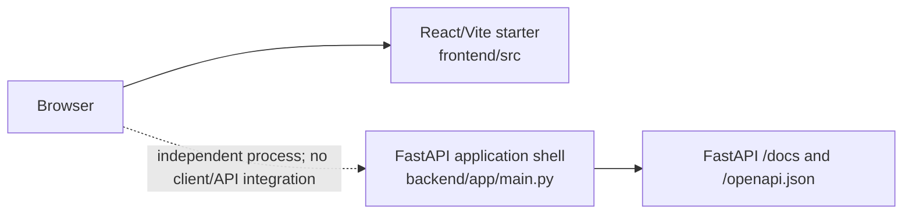
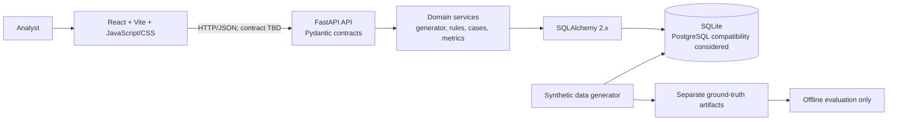
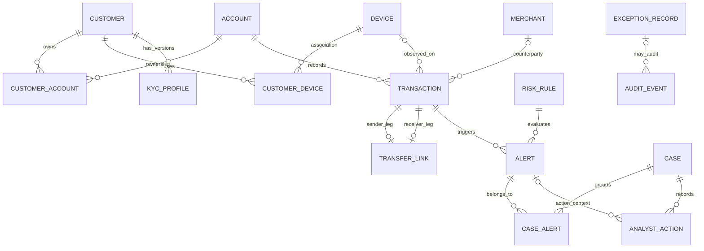
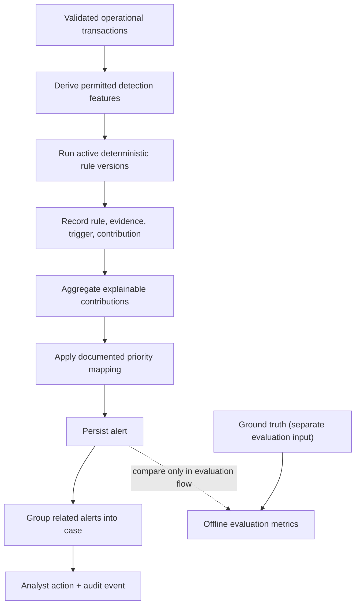

# RiskTrace AI: Architecture Reference

**Snapshot:** 2026-11-11. Diagrams distinguish implemented state from proposed design.

## Current implemented architecture

The frontend is a generic Vite/React starter and does not call the backend. The backend has no custom routes and no storage. There is no SQLite file, ORM model, schema, migration, or database connection in the repository.

## Target three-tier architecture (proposed)

The evaluation path is separate from detector input; domain services must not read ground-truth labels. Framework choices and target modules are specified by the project brief; the detailed interface, schema, API path conventions, auth, and deployment design remain unapproved.

## Proposed conceptual ER diagram (not implemented)

This is a candidate relationship outline based on the requested entity list. It is not a Phase 4 schema or an approved cardinality contract.

The ER notation is conceptual; resolve whether KYC is versioned, whether transfer legs can belong to multiple links, alert reassignment semantics, and exact audit/exception references before creating tables.

## API endpoints

### Implemented

There are **no custom application endpoints**. FastAPI's current framework routes are:

| Method | Path | Purpose |
|---|---|---|
| GET/HEAD | `/docs` | Swagger UI |
| GET/HEAD | `/redoc` | ReDoc |
| GET/HEAD | `/openapi.json` | Framework-generated schema |
| GET/HEAD | `/docs/oauth2-redirect` | Swagger UI support route |

`GET /` currently returns 404. This is expected for the empty application shell and is not a business endpoint.

### Candidate future contract (not implemented or approved)

| Candidate route | Intended use |
|---|---|
| `GET /api/v1/health` | Application readiness/health |
| `GET /api/v1/alerts` | Filter and prioritize alert queue |
| `GET /api/v1/cases` and `GET /api/v1/cases/{case_id}` | List/review cases and evidence |
| `POST /api/v1/cases/{case_id}/actions` | Record an analyst action/disposition |
| `GET /api/v1/metrics` | Return explicitly defined evaluation/operational metrics |

Agree path, payload, pagination, auth, errors, and versioning through API contracts before implementing these routes.

## Database relationship and integrity principles (target)

- Use explicit PK/FK constraints and uniqueness/indexes from the Phase 4 data dictionary.
- Model many-to-many customer/account and customer/device relationships using association tables.
- Associate each operational alert with a valid triggering transaction and an immutable rule-version reference/snapshot.
- Associate cases and alerts through `CaseAlert`; preserve action chronology and audit history.
- Treat transfers as two-leg relations with documented amount/currency/fee reconciliation semantics.
- Keep intentionally invalid fixtures outside valid operational records. Exception records should identify the rejected source/scenario and validation reason.
- Define monetary precision/currency and posting order before balance reconciliation.
- PostgreSQL compatibility is a future goal; validate portability explicitly rather than assuming it.

No one of these database behaviors is implemented yet.

## Target business/data flow

1. Seed master entities (customers, merchants, devices, accounts, KYC and associations).
2. Create transactions and transfer links using valid foreign keys.
3. Reconcile balances and validate transaction, account, and transfer invariants.
4. Keep ground-truth labels in a separate store/file/path and out of detector reads.
5. Evaluate deterministic, versioned rules on allowed detection inputs.
6. Save alert evidence, score contribution, rule version, trigger, time, and priority.
7. Group linked alerts into cases.
8. Record timestamped analyst actions and append audit events.
9. Compute metrics against ground truth in a separate evaluation path.
10. Export operational data and truth/metrics separately, with validation.

## Target risk evaluation flow

The score range, aggregation, thresholds, priority bands, review capacity, and metric definitions are open decisions. Never use ground-truth labels to create detector features, choose a triggering rule, or generate an alert.

## Exception handling (target)

The required invalid scenarios (closed account, unauthorized negative balance, unreconciled transfer, orphan alert, and disposition before alert) should be labeled and routed to a validation/exception path. Capture the scenario, offending input/reference, failure reason, and outcome; do not weaken operational foreign keys or chronology constraints to make invalid fixtures pass. Decide during schema/generator design whether invalid fixtures are rejected inputs, isolated `ExceptionRecord`s, or a separately flagged dataset.
