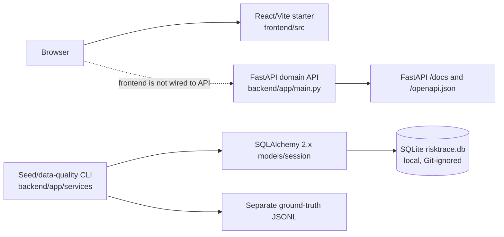
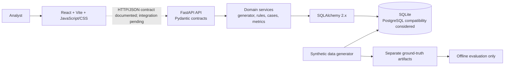
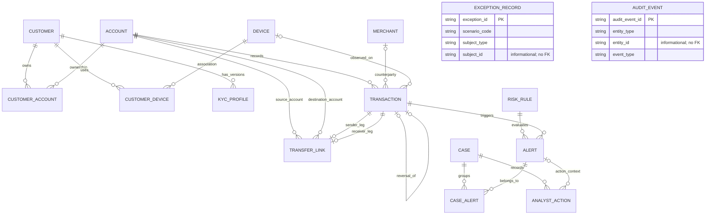
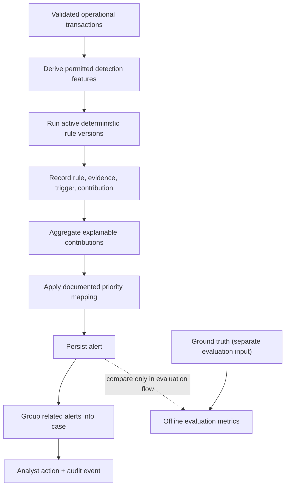

# RiskTrace AI: Architecture Reference

**Snapshot:** 2026-11-11. This reference distinguishes implemented Phase 5/6 behavior from future frontend and deployment work.

## Current implemented architecture

The frontend remains a generic Vite/React starter and does not call the backend. Phase 6 adds FastAPI domain routes and database-backed services. Phase 5 implements the SQLAlchemy persistence layer, Alembic migration, small deterministic seed/data-quality CLI, and separate ground-truth output; the local SQLite database is Git-ignored.

## Target three-tier architecture (proposed)

The evaluation path is separate from detector input; operational risk services must not read ground-truth labels. Phases 5 and 6 implement the schema, API contracts, detector, and backend workflows. Authentication, deployment, and frontend integration remain open.

## Phase 4 ER design and Phase 5 schema implementation

This diagram summarizes the implemented cardinalities in [the Phase 4 data dictionary](../04_database_design.md) and [Phase 5 implementation](../05_database_implementation.md); the detailed fields, optionality, constraints, and deletion policy there are authoritative.

The ER diagram includes all 16 entities. `AuditEvent.entity_type/entity_id` and `ExceptionRecord.subject_type/subject_id` are independent informational polymorphic references with no FK; the entities therefore have no relationship edge in the diagram. Transaction reversal is optional one-to-one.

## API endpoints

### Implemented

Implemented backend routes include:

| Method | Path | Purpose |
|---|---|---|
| GET | `/health` | Basic service health |
| GET | `/api/transactions` | Paginated/filterable transaction listing |
| GET | `/api/transactions/{transaction_id}` | Transaction detail |
| GET | `/api/accounts/{account_id}/transactions` | Account transaction listing |
| GET | `/api/accounts/{account_id}/links` | Evidence-backed account relationships |
| GET | `/api/alerts` | Filterable alert listing |
| GET | `/api/alerts/{alert_id}` | Alert detail |
| POST | `/api/risk/evaluate` | Evaluate transactions and persist eligible alerts |
| GET | `/api/cases` | Case listing |
| GET | `/api/cases/{case_id}` | Case detail |
| POST | `/api/cases/group` | Group related alerts into cases |
| POST | `/api/cases/{case_id}/actions` | Record analyst actions |
| GET | `/api/dashboard/summary` | Operational dashboard summary |
| GET | `/api/analytics/evaluation` | Separate ground-truth evaluation metrics |

FastAPI's documentation/framework routes are also available:

| Method | Path | Purpose |
|---|---|---|
| GET/HEAD | `/docs` | Swagger UI |
| GET/HEAD | `/redoc` | ReDoc |
| GET/HEAD | `/openapi.json` | Framework-generated schema |
| GET/HEAD | `/docs/oauth2-redirect` | Swagger UI support route |

`GET /` is not implemented. Route schemas, pagination, request/response behavior, rules, and limitations are specified in [Phase 6 backend development](../06_backend_development.md). The analyst identity is synthetic and unauthenticated; do not expose this demo service externally.

## Database relationship and integrity principles (Phase 5 implemented)

- Use explicit PK/FK constraints and uniqueness/indexes from the Phase 4 data dictionary.
- Model many-to-many customer/account and customer/device relationships using association tables.
- Associate each operational alert with a valid triggering transaction and an immutable rule-version reference/snapshot.
- Associate cases and alerts through `CaseAlert`; preserve action chronology and audit history.
- Transfers use same-currency equal debit/credit legs, paired with composite account/transaction FKs.
- Keep intentionally invalid fixtures outside valid operational records. The Phase 5 seed stores all five required scenarios as quarantined ExceptionRecord payloads.
- The implementation uses integer minor-unit USD amounts, UTC-aware application timestamps, deterministic `(transaction_at, transaction_id)` ledger ordering, and effective-dated ownership validation.
- SQLite migration/ORM guards protect FK integrity, immutable IDs/rule versions, and append-only action/audit history. PostgreSQL compatibility is a future goal; validate portability explicitly rather than assuming it.

The persistence schema, seed/data-quality workflows, backend rule execution, APIs, and evaluation service are implemented for the demo scope. Frontend integration is not.

## Target business/data flow

1. **Implemented for the small baseline:** seed master entities, associations, KYC, transactions, and transfer links using deterministic IDs.
2. **Implemented:** reconcile balances and validate FK, ownership, ledger, transfer, alert/case priority, and chronology invariants.
3. **Implemented:** write separate transaction-level ground-truth JSONL and quarantined ExceptionRecord fixtures.
4. **Implemented in Phase 6:** evaluate deterministic, versioned rules using permitted operational inputs only.
5. **Implemented in Phase 6:** persist detector-generated alert evidence, rule version, trigger, timestamp, score contribution, and priority.
6. **Implemented in Phase 6:** group related alerts into cases and record analyst actions/audit events through business operations.
7. **Implemented in Phase 6:** compute evaluation metrics against separate ground truth; additional metric validation/export remains future work.

## Target risk evaluation flow

The approved demo score aggregation is sum-and-cap at 10,000 bps; priority is P1 >= 7,500, P2 >= 5,000, P3 >= 2,500, otherwise P4. Case priority is the highest linked-alert priority. These are policy defaults, not validated calibration. The Phase 6 detector and evaluation service are implemented; their demo metrics are not a real-world performance claim. Never use ground-truth labels to create detector features, choose a triggering rule, or generate an alert.

## Exception handling (target)

The Phase 5 seed creates quarantined ExceptionRecord payloads for all required invalid scenarios (closed account, unauthorized negative balance, unreconciled transfer, orphan alert, and disposition before alert). Do not weaken operational foreign keys or chronology constraints to make invalid fixtures pass. Phase 6 adds API validation; Phase 7 remains responsible for deeper edge-case and performance testing.
